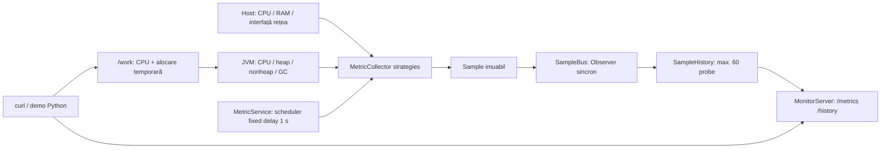

# Arhitectura M1 și evoluția controlată

Referință citită: [documentul de proiect](https://docs.google.com/document/d/1b2V2F_tXxN0KFD0JrUffe9UveudilWuftfXu2A1e0iU/edit?tab=t.0),
inclusiv **toate cele patru diagrame** din exportul HTML, la 14.11.2026.
Repository-ul inițial conținea doar titlul README; nu exista un enunț de
laborator separat. Cele șase teme obligatorii M1 provin din cerința aprobată.
Nu pretindem că am verificat un termen M2 într-un document oficial inexistent aici.

## Adaptarea diagramelor de referință

1. Fluxul CPU/memorie/disc → scheduler → buffer → distribuție → storage/API/UI,
   plus alertare/notificări: păstrăm fluxul de colectare și inspecție; eliminăm
   **discul, UI-ul, live feed-ul, alertarea și notificările**. Adăugăm doar
   resursele cerute: rețea, JVM memory/heap și GC.
2. Cele trei puncte de variație — colectori, buffering, distribuție — rămân
   responsabilități distincte. Numele complete ale comparațiilor sunt cele din
   tabelul documentului, inclusiv Abstract Factory, SPI și Ring Buffer.
3. Păstrăm evaluarea sub aceleași scenarii idle, nominal, high-frequency, burst,
   cu aceleași măsurători și raport comparativ. Rezultatele comparative sunt viitoare.
4. Păstrăm modele/interfețe comune fără biblioteci externe. M1 folosește un singur
   JVM; nu implementăm toate modulele desenate ca servicii independente.

## Fundația implementată

Serverul web și serviciul de metrici sunt componente din același proces Java.
`Main` le compune explicit. Colectorii nu cunosc HTTP; serverul nu citește direct
sursele OS/JVM. Obiectele `Sample` sunt imuabile; accesul la istoric este sincronizat.
Publicarea Observer este sincronă, pe firul schedulerului, fără coadă de evenimente.
Un consumator lent întârzie următoarea probă; această limită este intenționată
pentru M1 și trebuie măsurată înainte de a introduce un event bus asincron.
Subscriberii se înregistrează la pornire, înaintea schedulerului.

Istoricul păstrează cel mult 60 de probe și elimină proba cea mai veche. Este
un `ArrayDeque` limitat logic, **nu** varianta Object Pool + Flyweight/Ring Buffer.
Executorul HTTP are 4 fire și coadă limitată la 64 de cereri; când este plină,
`CallerRunsPolicy` aplică backpressure pe dispecer. Nu este infrastructură de producție.
Limita `/work` este de 5.000.000 iterații și 256 KiB per cerere activă.

Erorile surselor de rețea sunt logate și reprezentate prin indisponibilitate.
O eroare neașteptată de eșantionare este logată cu stack trace, vizibilă în
`/health` (503), și schedulerul încearcă din nou. Nu sunt fabricate probe.

## Cele trei comparații — fără substituții

| Comparație exactă | Responsabilitate și flux comun | M1 | Variante planificate |
|---|---|---|---|
| **A. Observer / Pub-Sub (event bus, push) versus Busy Polling / Spin-Wait** | Proba colectată → notificare către consumator / predicat de detecție din harness | Observer sincron, push către istoric | Event bus push comparat cu un consumator care verifică repetat același slot; același sampler în ambele |
| **B. Strategy + Abstract Factory + SPI registry versus God Object (The Blob)** | Surse CPU/RAM/rețea/JVM/GC → colectori → același `Sample` | Interfață Strategy + compoziție manuală | Factory de familie OS/JVM; furnizori `ServiceLoader` în registru SPI; alternativ un Blob cu aceleași surse |
| **C. Object Pool + Flyweight over bounded Ring Buffer versus Object Churn + Unbounded Collection** | Probele aceleași → retenție/consum → inspecție | Probe imuabile + deque limitat, fără pooling | Sloturi reutilizate, metadate Flyweight și ring cu capacitate fixă; alternativ obiecte noi și colecție nelimitată |

### Reguli pentru variantele M2

**A:** eșantionarea periodică este necesară pentru citirea resurselor și există
identic în ambele variante. Busy polling este numai așteptarea activă a
**consumatorului** pentru o probă nouă, nu schedulerul de 1 s și nu refresh-ul
manual prin `curl`. Harness-ul poate verifica un prag fără subsistem de alertare.
Politica de livrare/pierdere și numărul consumatorilor vor fi identice.

**B:** factory-ul va crea familii de colectori pentru o platformă, iar registrul
SPI va descoperi aceleași responsabilități prin `java.util.ServiceLoader`.
Nu adăugăm aceste straturi doar pentru a bifa nume la M1.

**C:** ownership-ul unui slot trebuie transferat exclusiv; cititorii HTTP nu
primesc referințe mutabile reutilizate. Se va face copiere la granița API sau
snapshot coerent; costul acelei copii va intra în măsurători. Flyweight se aplică
metadatelor de metrică partajate, nu unei probe care își schimbă timestamp-ul.
La saturare, ring-ul folosește o politică explicită (plan: overwrite oldest,
cu contor de suprascrieri). Varianta nelimitată păstrează intenționat istoricul
în plus; diferența de retenție este parte a axei C, nu o „optimizare” ascunsă.

Protocolul comparativ și limitele echivalenței sunt în
[EXPERIMENTS.md](EXPERIMENTS.md).
